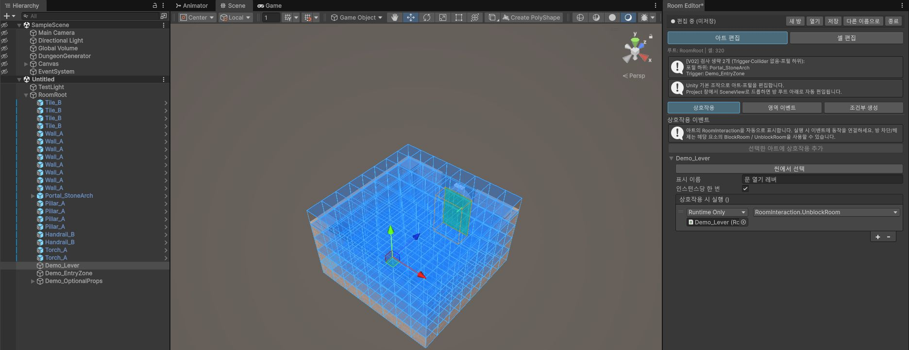

# Procedural Level Generator & Unity Room Editor

**첫 주의 셀 편집에서 절차적 맵 생성·최적화·통합 제작 툴까지 확장한 AI 협업 프로젝트**

`Unity 6` `C#` `UI Toolkit` `Editor Tool` `AI-assisted Development` `Optimization`

예약 공간, 방 아트, 포털과 게임 규칙을 통합 편집하고 기존 맵 생성기에 전달하는 도구입니다. 저는 제작 목적과 입력 방식, 데이터 책임, 기존 시스템과의 호환 범위를 결정하고, AI를 활용해 명세 구체화·코드 구현·검증·문서화를 반복했습니다.

> **AI 활용 공개:** 이 프로젝트에는 AI가 작성·수정한 코드와 문서가 포함되어 있습니다. 모든 코드를 수작업으로 작성한 프로젝트로 소개하지 않습니다. 핵심 경험은 요구사항을 구체화하고, 제안을 검토·수정하며, 실제 실행 결과를 근거로 다음 결정을 내리는 개발 과정입니다.



## 읽는 순서

- [1주차부터 전체 개발 과정과 생성기 코드](docs/PROJECT-HISTORY.md)
- [AI 협업 방식과 나의 역할](docs/AI-WORKFLOW.md)
- [설계가 바뀐 이유와 개발 과정](docs/DESIGN-EVOLUTION.md)
- [최적화와 비용 제어](docs/OPTIMIZATION.md)
- [구조와 코드 지도](docs/ARCHITECTURE.md)
- [검증 결과와 남은 범위](docs/VERIFICATION.md)
- [사용자 매뉴얼](docs/USER-MANUAL.docx)

## 처음부터 만든 시스템

`셀 범위·편집 → 포털 정렬 → 예약 영역 충돌 검사 → DFS·복구 → AABB 최적화 → 통합 편집·게임 규칙`

- **제작 기반:** 첫 주의 로컬 셀 표시에서 직렬화, 드래그 편집, Undo/Redo와 입력 취소 처리로 확장했습니다.
- **생성기:** 방 역할별 후보 풀, 깊이별 시나리오, DFS 분기, 후보 재시도, 유일 단계 대체 말단과 체크포인트 역순 복구를 구성했습니다.
- **공간 판정:** 회전된 예약 박스의 정밀 겹침 검사 앞에 AABB 필터를 추가하고 박스·경계를 재사용했습니다.
- **통합 제작:** 이후 공간·아트·포털을 하나의 편집 환경으로 묶고 방 인스턴스별 규칙을 연결했습니다.

“기존 생성 알고리즘 유지”는 후반 통합 작업의 제약입니다. 초기 생성기 개발도 이 프로젝트의 일부입니다. WFC는 초기 검토 주제이며 구현 성과로 포함하지 않습니다.

## 어떤 도구인가

아트에 맞춰 셀 범위를 수작업으로 지정하거나, 먼저 만든 셀 범위 안에 아트를 배치할 수 있습니다. 완성된 방은 BlockData와 방 아트 프리팹으로 저장하고 생성 라이브러리에 등록합니다.

```text
아트 선행 ─┐
          ├─ 공간·아트 통합 편집 → 포털·선택적 규칙 → 검사·저장 → 생성기
공간 선행 ─┘
```

| 기능 | 구현 내용 |
|---|---|
| 공간 편집 | 한 칸 클릭, XZ 드래그 후 높이 조정, 선택·이동·삭제, Undo/Redo |
| 아트 편집 | 전용 편집 씬의 RoomRoot 아래에 모델을 구성하고 프리팹으로 저장 |
| 포털 | 자유 위치, Y축 45도 단위 방향, 동일 디자인·개구부 규격 연결, 개별 예약 깊이 |
| 상호작용 | UnityEvent 연결, 인스턴스별 일회 실행, 방 차단·해제 |
| 영역 이벤트 | 진입·이탈·머무름, 태그·레이어 필터, 다중 Collider 처리 |
| 조건부 생성 | 방 내부 대상의 확률별 활성·비활성, 인스턴스당 1회 초기화 |
| 기존 생성기 연동 | 배치·재시도·충돌 로직을 유지하고 데이터와 런타임 초기화 경로 연결 |

## 내가 주도한 결정

1. **셀은 아트 조립 단위보다 예약 공간에 집중하도록 재정의했습니다.** 대각선 포털 주변을 셀 부품으로 메우는 시도에서 제작 목적을 다시 검토하고, 아트 배치의 자유도를 확보하는 방향으로 전환했습니다.
2. **공간과 아트를 하나의 편집 흐름으로 통합했습니다.** RoomRoot 아래 디자인을 구성하고, 방 하나의 셀·포털·아트 참조를 BlockData로 묶도록 했습니다.
3. **기존 생성 알고리즘을 유지하는 제약을 두었습니다.** 기능 추가를 위해 배치 탐색 자체를 다시 만드는 대신 데이터 변환과 초기화 연결 범위를 구분했습니다.
4. **입력과 검증 기준을 구체적으로 지정했습니다.** 짧은 클릭과 범위 드래그를 통합하고, 드래그 후 높이 조절, 확정 전 데이터 불변, 취소와 Undo 동작을 점검 항목으로 만들었습니다.

## 최적화에서 다룬 문제

초기에는 생성기의 쌍별 충돌 검사 비용을 줄였고, 이후 에디터와 런타임의 반복 작업을 제어했습니다.

**AABB 도입 당시 사용자 측정 집계:** OFF/ON 각각 20개 시드 × 2회, 총 80회에서 평균 Process 시간 **약 6.595초 → 0.601초(약 11배)**, Overlaps 진입 **약 4,443만 → 339만 회**. 이번에 재측정한 결과가 아니며, 개별 로그·실행 환경과 결과 동등성 재검증은 남아 있습니다. [출처와 한계](docs/OPTIMIZATION.md)를 함께 공개합니다.

- 공간 검사 결과를 일정 시간 재사용하고 상태 관찰 주기를 제한했습니다.
- HashSet으로 셀 중복을 제거하고 실제 변경이 없는 작업의 Undo 생성을 피했습니다.
- 다중 Collider가 같은 액터의 이벤트를 반복 실행하지 않도록 추적했습니다.
- 머무름 이벤트에 실행 간격과 물리 스텝 중복 방지를 적용했습니다.
- 조건부 생성을 인스턴스당 한 번 초기화하고 기존 생성기의 난수 소비와 분리했습니다.

위 에디터·이벤트 항목의 개별 개선율은 측정하지 않았습니다. **초기 생성 시간 집계와 완성 씬의 FPS·메모리 성능은 구분합니다.** 자세한 구현과 측정 계획은 [최적화 문서](docs/OPTIMIZATION.md)에 정리했습니다.

## 검증에서 찾고 수정한 사례

Play 중 편집기의 자동 편입이 생성된 방을 RoomRoot 아래로 가져가는 문제가 있었습니다. 편집과 실행 상태를 분리하고 Play 중 자동 편입·기본 부모 지정을 중단한 뒤 생성 회귀 검사를 다시 수행했습니다.

- 수정 전: 30방 데이터와 10시드 생성 검사에서 **13 PASS / 27 FAIL**
- 수정 후: 동일 검사 범위에서 **40 PASS / 0 FAIL**

이 결과는 기능 회귀 검사이며 성능 벤치마크가 아닙니다. [검증 범위와 증거](docs/VERIFICATION.md)를 함께 공개합니다.

## 공개 범위와 현재 상태

이 저장소는 **핵심 소스 스냅샷과 개발 과정 문서로 구성한 코드 포트폴리오**입니다. 실행 가능한 전체 Unity 프로젝트나 배포용 UPM 패키지는 아닙니다. 원본의 씬·GUID·외부 패키지·콘텐츠 구성이 빠져 있어 그대로 열거나 복사하는 것만으로 실행을 보장하지 않습니다.

외부 모델·재질·상용 에셋 원본은 포함하지 않았습니다. 화면의 던전 아트는 외부 DungeonModularPack 에셋을 활용한 예시이며 직접 제작한 모델로 주장하지 않습니다.

캐릭터 통행과 완성 씬 성능 측정은 후속 과제입니다. 이번 주에는 매뉴얼 기반으로 실제 제작 흐름을 사용하며 조작·가독성·상태 안내·반복 작업의 불편을 기록하고 폴리싱 우선순위를 정할 계획입니다.

공개 커밋은 현재 상태의 스냅샷입니다. 원본 개발 기간의 커밋 이력을 재현하거나 AI 기여 비율을 추정하지 않았습니다.
